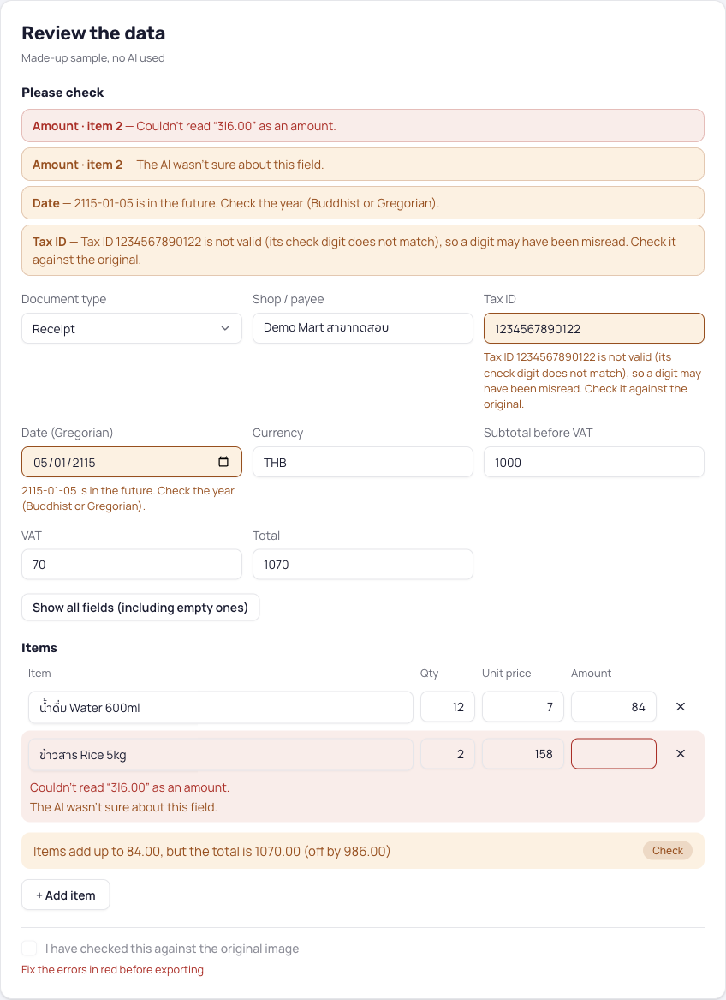

# eve Thai Receipt Extension

Turn photos of **printed** Thai receipts, tax invoices and bank transfer slips into checked, editable data (JSON / CSV). It comes as a web app, a TypeScript library, and an extension for [eve](https://eve.dev) agents.

[](https://github.com/mintelligence-dev/eve-thai-receipt-extension/actions/workflows/ci.yml)
[](LICENSE)
[](https://eve.dev)
[](https://nextjs.org)
[](https://www.typescriptlang.org)

**English** · [ภาษาไทย](README.th.md)

**Live demo: <https://eve-thai-receipt-extension.vercel.app>.** Try the built-in samples first; they don't call the AI. A document you upload is read by the AI model and not stored. Please don't upload other people's receipts or slips.



<sub>Built-in sample with invented data; no AI call.</sub>

Open-source AI tool that turns **printed** Thai receipts and bank transfer slips into editable, structured data (JSON / CSV). For small shops, freelancers and developers building expense tools. A person always reviews the result before anything is exported.

### What it does

- Upload a photo, or take one on your phone. Photos are resized on your device first (see [Privacy](#privacy-and-data)).
- **PDF files work too** (for example a receipt saved or emailed as a PDF). Each page is turned into an image on your device and then handled like a photo, so up to 4 pages are read as one receipt. A PDF with more pages is refused rather than cut short, because it may hold several receipts, and a password-protected PDF is refused. Only a PDF that is a scan or a picture is tested; the text inside a PDF is not used.
- **A very long receipt can be photographed in up to 4 photos**, in order from top to bottom, overlapping by a few lines. They are read as one receipt, and the app **checks that they really are the same one**: photos that look like different receipts are refused with a message instead of being merged.
- **Receipts and tax invoices:** shop name, shop tax ID, receipt number, date and time, subtotal, VAT, total and line items.
- **Transfer slips:** payee, payer, amount, fee, reference number, date and time.
- Reads Thai numerals (๑๒๓), Buddhist Era dates (`12/05/2568` → `2025-05-12`), Thai and English month names, two-digit years, `฿` / `บาท` / `BHT` / `THB`, and mixed Thai–English text.
- Understands common receipt layouts: prices followed by a tax-class letter (`48.75 N`), prices with a unit suffix (`41.00 / ชิ้น`), add-on lines whose price is already included in the line above, and discounts shown as negative lines.
- **Flags what a person should check** (yellow = please confirm, red = must fix before export). See [What it checks](#what-it-checks).
- Review and edit every field. The files you will get (JSON and CSV) are previewed live under the form. Export stays locked until you tick "I have checked this against the original" and no red errors remain.
- Thai and English interface, light and dark theme.

### What it does not do

- **Extraction only.** A picture cannot prove a receipt or a slip is genuine, so the app never says so from the picture. For transfer slips there is an optional check with the bank (see [Checking a slip with the bank](#checking-a-slip-with-the-bank)); it is off unless you set it up.
- **Printed documents only. Handwriting is refused**, not read badly: handwritten numbers came back differently on every run in our tests (the same amount as 200,000, 2,000,000 and 2,009,000), with nothing on screen to warn you.
- Up to 4 photos of **one** document. Different receipts are never merged (see "How reliable is it?" for how well that is checked). There is no batch mode for many receipts yet.
- No accounting-system integrations and no automatic sending anywhere.
- It does not store your images (see [Privacy](#privacy-and-data)), and it has no accounts or history.

### How reliable is it?

Honestly: good, not perfect, and it varies between runs of the same photo. On our small private test set (three shop receipts and four bank slips from different banks) the default model read the shop, date, total and VAT correctly in most runs. The mistakes we saw most:

- **Thai numerals in small print** (for example `๑๘๕.๐๐` read as `145`).
- **Thai numerals written in another script's digits**, most often Bengali (`৬০.০০` for `๖๐.๐๐`). The value is usually right; it is converted and flagged yellow.
- Lines with several prices, long receipts, faded thermal paper, tilted or blurry photos.
- Values that are partly covered or cut off.

**Several photos of one receipt.** The model reads them together and also reports what each photo shows on its own (shop, tax ID, date, total); the code compares those, so photos of different receipts are refused even if the model thought they matched. On our small test set, 12 of 12 pairs of different receipts were refused (real and synthetic, including the same shop on another day), and a long synthetic receipt with three identical lines inside the overlap merged correctly 3 of 3 times. Real photos cut into two parts merged with the same quirks as single photos (for example a heading line counted as an item). What it cannot do: two photos that show none of the shop, tax ID, date or total (for example two middle sections) can only be caught by the model's own judgement and the totals check, so always read the merged result.

That is why the app cross-checks the numbers and asks you to confirm anything doubtful. **Always compare against the original.** Before changing the model, run [`pnpm bench`](bench/README.md) on your own documents: models differ a lot (one made up a whole receipt from a blank image).

### What it checks

| Flag | Meaning |
|---|---|
| Items don't add up | Line items must add up to the total, subtotal, or total minus VAT (live bar under the items). |
| VAT | Checked against 7%. Receipts that mix VAT and VAT-exempt items are accepted when 1–3 items add up to the exempt part. |
| Tax ID | 13 digits with the Thai check digit. A misread digit almost always breaks it. |
| Dates | Not in the future, not over 10 years old; a two-digit year is shown with how it was read. |
| Other-script digits | A value the model wrote in Lao, Bengali, Devanagari, Myanmar or Khmer digits is converted by its value and flagged yellow, to compare with the paper. |
| Amounts | An amount with more than two decimals (`5.555`) is never guessed. A negative amount needs a name that says discount or promotion (`discount`, `promotion`, `ส่วนลด`, `ลดราคา`, `โปรโมชั่น`, `โปรโมชัน`); other names, such as `BOGO`, are flagged. |
| Model unsure | Fields the model said it could not read confidently, or values that were hidden or cut off. |
| Not a receipt | Blank, unreadable or unrelated images must be confirmed before anything is exported. |
| Several photos | Photos that look like different receipts are refused. A merged result always carries a yellow "check the lines where the photos meet" flag, and the items-vs-total bar still applies. |
| Assumed values | A line with only a price is shown as quantity 1 × price (faded italic, marked `assumed` in the JSON). Not done for discounts or unclear layouts. |

### How it works

The model only **transcribes** text exactly as printed (output validated with Zod through the Vercel AI SDK). Deterministic TypeScript then parses digits, dates and amounts (integer satang, so no floating-point error) and runs all the checks above. Prices never come from the model's arithmetic. See [`packages/extractor`](packages/extractor).

```
packages/extractor       Reusable TypeScript package: extract, normalise, validate, export, score
packages/eve             eve extension: read, correct and export documents attached in a chat
examples/thai-receipt-agent  Example app: the Next.js web demo (upload → review → preview → export)
                         and an eve agent that mounts the extension, in one project
bench/                   Compare vision models on your own documents
```

### Export formats

JSON is the full structure. CSV holds every value the JSON holds except `flags` and a line item's `assumed`, which describe how the numbers were read rather than the document (a test keeps the two in step). CSV has one row per line item, with the document fields repeated, a UTF-8 BOM so Excel opens Thai text correctly, and spreadsheet-formula characters neutralised:

`document_type, document_subtype, merchant, merchant_address, branch, date, time, currency, subtotal, total_discount, taxable_amount, exempt_amount, vat, total, total_in_words, payer, reference, book_number, reference_document, fee, tax_id, recipient_name, buyer_name, buyer_address, buyer_tax_id, payment_method, has_signature, bank_check, bank_check_reason, bank_provider, bank_checked_at, bank_amount, bank_fee, bank_date, bank_trans_ref, bank_sender_bank, bank_sender_name, bank_receiver_bank, bank_receiver_name, slip_qr_bank, slip_qr_reference, item_code, item_description, item_quantity, item_unit, item_unit_price, item_discount, item_amount`

**Receipt fields.** Besides the shop, the date and the amounts, a receipt or tax invoice is read for the things Thai receipts are required to show: its title (`document_subtype`: receipt, receipt and tax invoice, or tax invoice), the book and receipt numbers, the seller's address and branch, the buyer's name, address and tax ID, the discount, the amounts with and without VAT, the total **in words**, how it was paid, and whether the receiver signed (only whether, never the signature). Each line item can also carry a code, a unit of measure and a discount. A field the receipt does not print stays empty. On the review screen **fields with no value are hidden**, and one button shows them all; a field a check has something to say about, or that you have just cleared to retype, stays in sight.

Two of the new checks are worth knowing: the total in words is read as a number and compared with the total in figures (a misread digit or word shows up as a warning), and the VAT is compared with 7% of the amount subject to VAT. The buyer's tax ID is checked with the same check digit as the seller's. A buyer's tax ID can be a person's ID number; the system prompt lets the model output it only in that field, and it is in the export like the other buyer fields, so treat the file as holding personal data.

For a transfer slip, `merchant` is the payee (the shop name when the slip shows one) and `reference` is the transaction reference; `recipient_name` is the account holder's name when the slip shows both a shop name and a person's name. For a receipt, `reference` is the receipt number.

The `bank_*` columns are empty unless the slip was checked with the bank (see [Checking a slip with the bank](#checking-a-slip-with-the-bank)). `bank_check` is `verified` (the bank has this transfer), `not_found`, `pending` (too recent to tell) or `unavailable` (the bank or the service could not answer, which says nothing about the slip); `bank_check_reason` says why when it is `unavailable`; the other columns say which service was asked, when (ISO time), and the amount, fee, date and time (with offset), reference, the two banks' codes and **the sender's and receiver's names** the **bank** reported. `slip_qr_bank` and `slip_qr_reference` are what the slip's QR code itself holds. The JSON has the same under `verification` and `slipQr`.

### Setup

Requires Node 24+ and pnpm.

```bash
pnpm install
cp examples/thai-receipt-agent/.env.example examples/thai-receipt-agent/.env.local   # add AI_GATEWAY_API_KEY
pnpm dev     # the web demo and the agent, http://localhost:3000
pnpm test    # all tests
```

No key yet? On the page, press one of the synthetic samples (or open `/?sample=transfer-slip`, `/?sample=thai-receipt`, `/?sample=needs-review`, `/?sample=addon-discount`) to try the review screen without calling a model.

| Variable | Default | Purpose |
|---|---|---|
| `AI_GATEWAY_API_KEY` | – | [Vercel AI Gateway](https://vercel.com/docs/ai-gateway) key. Not needed on Vercel if you use OIDC. |
| `RECEIPT_MODEL` | `google/gemini-2.5-flash` | Any vision model on AI Gateway (`provider/model`). The review screen shows which model read each document. |
| `RATE_LIMIT_PER_HOUR` | `10` | Requests per visitor IP per hour (best effort, see below). |
| `RATE_LIMIT_PER_DAY` | `200` | Requests for the whole site per day. |
| `SLIP_VERIFY_PROVIDER` | *(off)* | `easyslip`, `slipok` or `slip2go` turns on the optional bank check for transfer slips. |
| `SLIP_VERIFY_API_KEY` | | Your key for that service (for Slip2Go, the shop's Secret Key). Needed together with the provider. |
| `SLIP_VERIFY_BRANCH_ID` | | SlipOK only: the branch the key belongs to. |
| `SLIP_RATE_LIMIT_PER_HOUR` | `20` | Bank checks per visitor IP per hour. |
| `SLIP_VERIFY_CACHE_DIR` | *(off)* | **Development only.** A folder in which confirmed bank answers are kept and replayed, so testing does not spend the service's quota. The files hold names and figures: keep the folder out of version control (`bench/private/` is). |

With the default model, thinking is capped (1,024 tokens). Reading a receipt is mostly transcription, so unlimited thinking only added time and cost: a 17-item receipt took ~40 s and ~2¢ uncapped, and ~9–13 s and ~0.5¢ capped, with no loss of accuracy. Turning thinking off completely halves the cost again but cost about 11 points of accuracy on our test set (98% → 87%), so it is not recommended (`pnpm bench -- --thinking 0` lets you test it).

The page shows what the model has read as it goes (the API's `?stream=1` mode sends one JSON object per line). The model thinks for several seconds before it writes anything, so the first fields appear late (about 10 s of 13 s on a long receipt) and the total time is unchanged. A handwritten document is refused as soon as the model says so, without waiting for the rest.

### Use the package

```ts
import { extractReceipt, DifferentDocumentsError, HandwritingNotSupportedError, toCSV } from "@eve-thai-receipt-extension/extractor";

try {
  const { receipt, usage } = await extractReceipt({
    image: bytes,                     // Uint8Array of a JPEG, PNG or WebP
    mediaType: "image/jpeg",
    model: "google/gemini-2.5-flash", // any vision model on AI Gateway
    // A long receipt in several photos, top to bottom (up to 4), instead of `image`:
    // images: [{ image: top, mediaType: "image/jpeg" }, { image: bottom, mediaType: "image/jpeg" }],
  });
  receipt.flags;                      // what a person should check
  toCSV(receipt);
} catch (e) {
  if (e instanceof HandwritingNotSupportedError) { /* ask for a printed document */ }
  if (e instanceof DifferentDocumentsError) { /* the photos are not one receipt: e.conflicts says what differs */ }
}
```

Browser-safe helpers (no model code), such as `normalizeExtraction`, `revalidate`, `itemsReconcile`, `toJSON` and `toCSV`, are at `@eve-thai-receipt-extension/extractor/core`.

### Use with eve

[`@eve-thai-receipt-extension/eve`](packages/eve) is an [eve](https://www.npmjs.com/package/eve) extension: a person sends a photo of a receipt or slip to your agent in a chat, checks what was read, corrects it in their own words and asks for the file. **It is not on npm yet:** use it from this workspace (`"@eve-thai-receipt-extension/eve": "workspace:*"`), as the example agent does. Mount it in your agent:

```ts
// agent/extensions/receipt.ts
import receipt from "@eve-thai-receipt-extension/eve";

export default receipt({ model: process.env.RECEIPT_MODEL || undefined }); // default google/gemini-2.5-flash
```

The agent gets three tools (named after the mount, here `receipt__…`):

| Tool | What it does |
|---|---|
| `read_document` | Reads one document from up to 4 attached photos (JPEG, PNG or WebP), with the same extractor and checks as the web app. Returns an id, the values read, and what must be fixed (`mustFix`) or checked (`pleaseCheck`). |
| `correct_document` | Applies what the person says the paper shows. Values are passed as typed (`"๑,๒๕๐"`, `"12 พ.ค. 68"`) and parsed by the extractor, so the agent never converts a year or works out an amount. Every check runs again. |
| `export_document` | CSV or JSON, as described in [Export formats](#export-formats). **Refused while anything must still be fixed**, like the web app's export lock. |

The documents are kept in the eve session, not in a database. The extension's instructions tell the agent never to take a figure from the photo itself (eve shows the agent the photo too) and to pass on a tool's message when it refuses. [`examples/thai-receipt-agent`](examples/thai-receipt-agent) mounts it beside the web demo: `pnpm install`, then `pnpm dev:agent` opens the eve terminal UI, and `pnpm --filter thai-receipt-agent eval` reads and exports a synthetic receipt end to end (it calls the models, so it needs AI Gateway credentials).

What the eve path does **not** do yet, and how its privacy differs from the web app:

- **No PDF and no bank check.** Both use browser code here (pdf.js, and jsQR to find the slip's QR code). A PDF or HEIC file is refused with what to send instead.
- **Photos are not shrunk or cleaned first.** In the web app the browser removes EXIF data such as the GPS location before upload; in a chat the photo reaches the agent as the person sent it, and eve keeps a copy in the session's sandbox (`/workspace/.eve/attachments/`) for the life of the session.
- **The image goes to a model twice:** to the agent's own model, which eve shows each attached image to (up to 3 MiB), and to the model that reads the document. Choose both, and the channel, with the same care as in [Privacy and data](#privacy-and-data).

### Checking a slip with the bank

A forged slip looks as real as a genuine one, so the picture alone proves nothing. What can be checked is the small **"Slip Verify" QR code** that banks print on a transfer slip: it holds the sending bank and the transaction reference, which a verification service can look up with the bank. The app then compares the **amount and date the bank reports** with the slip. A copied QR code on a slip whose amount was edited is caught that way: the bank's amount differs, so the amount is marked red and export is locked until it is put right.

- **Off by default.** Choose a service with `SLIP_VERIFY_PROVIDER`, and give it your own account's key: `easyslip` ([EasySlip](https://easyslip.com)) needs `SLIP_VERIFY_API_KEY`; `slipok` ([SlipOK](https://slipok.com)) needs `SLIP_VERIFY_API_KEY` and `SLIP_VERIFY_BRANCH_ID`; `slip2go` ([Slip2Go](https://slip2go.com)) needs `SLIP_VERIFY_API_KEY`, which is the shop's Secret Key. The services charge for use; check their current prices, free allowance and terms yourself. Without a complete setup, the page only says the check is not set up.
- **Nothing is sent until the person presses "Check with the bank".** The QR code is found on the device, and only its **text** (the sending bank's code and the transaction reference) is sent, through your server, to the service. The slip image is not sent. The service replies with the bank's record; the app keeps the transaction reference, date and time, amount, fee, the two bank codes and **the sender's and receiver's names as the bank gives them** (they are what the slip's names are compared with, and they are in the exported JSON, so treat that file as holding personal data), but **no account numbers**.
- **What is compared with the bank's record.** Once the bank has the transfer, the slip is compared with it field by field, and each difference shows beside its field: the **amount** and the **date** (red, export locked), and, as yellow warnings for the person to look at, the **time** (a minute either way), the **payer's name**, the **receiver's name** (the shop name or the account holder's name, whichever the bank holds) and the **reference**. Names are compared after dropping titles (นาย, น.ส., Mr...) and a company's legal form (บริษัท, จำกัด, Co., Ltd.), and agree when one holds the other, so a name cut short, a second line, or a shop name followed by a cut-off account holder's name do not warn. A letter the model misread does warn, with the bank's spelling beside it, which is the point (for example a surname read with the wrong consonant). A name written in Thai on the slip and in English by the bank warns too; the person can dismiss it. None of this proves a slip is real: the fields it compares are the ones the bank reports.
- **Finding the QR code** is done on the device by scanning the picture in parts, first as it is and then enlarged. It found the code in 11 of 11 real slips tried: 7 screenshots and 4 phone photos of a screen (tilted, with glare). Those photos had been shrunk by a messaging app, so a full-size camera photo should be easier, but one with a small, blurred or cropped code will not be found; the page then says so, which does not mean the slip is fake. Hard photos can take a second or two on a computer, longer on a phone.
- **A check that needs no service.** As soon as the QR code is found, the reference the model read from the picture is compared with the one inside the code, on the device: nothing is sent and it works even when no bank check is set up. A mismatch (an `I` read as `l`, a dropped digit, or a slip whose reference was changed but whose QR code was not) is a yellow warning with the two values and a button to use the QR code's value; the person decides. Agreement proves nothing about the slip: the code holds no amount or date, so a slip with an edited amount passes. On the 11 real slips tried (SCB, Bangkok Bank, K PLUS) the reference in the code always equalled the printed one; other banks are untested. The code's content is kept in the JSON as `slipQr`. Once the bank has answered, its own reference is compared instead, so a mismatch is not reported twice.
- **Results, in plain words:** the bank *has* the transfer and the figures match (green); the bank has it but the **amount or date differs** (red, export locked); the bank has *no* such transfer (yellow: the slip may be forged, but the transfer may also be too new or from a bank the service cannot check); the bank cannot tell yet (yellow); the service could not answer (shown as an error, **not** as a verdict on the slip). If an edit changes the amount or date later, it is compared with the bank's figures again. The JSON and CSV exports record the result (`verification`, `bank_check`).
- **What it does not check:** that the receiver is *your* account (names and accounts are masked differently on each slip, so they are not compared), or that the same slip was not already used for another order (EasySlip can check that but this app does not use it). A slip without a visible QR code, or from a bank whose QR code the service cannot read, cannot be checked, which does not mean it is fake.
- **How far each is tested.** Slip2Go has been tried against the live service with five real slips (four SCB, one Bangkok Bank): four were confirmed with the right amount and date; the Bangkok Bank slip got "Bank error, please try again" twice, which the page shows as "could not answer", not as a verdict. EasySlip (API v2 pages) and SlipOK (API guide 1.13) were written from their public documentation and tested only against local stand-ins that answer in the documented shapes, **not yet against the live services**. A change in an answer format would show up as "could not answer", never as a verified slip.
- **Notes on SlipOK:** the request never sets its `log` option, so SlipOK keeps nothing about the slip and does no duplicate check; every valid check, and every repeat of one, uses a unit of its quota; slips from Bangkok Bank and SCB can need a few minutes before they can be checked (shown as "cannot confirm yet"); its guide gives two different error codes for "no such transaction" (1011 and, in an example, 1007), and both are read as not found.
- **Notes on Slip2Go:** the request carries no `checkCondition`, so Slip2Go does no duplicate, amount, date or receiver check (this app compares amount and date itself). It has no "too recent" answer, so a very new Bangkok Bank or SCB slip may come back as "not found". Its "slip is fraud" answer is shown as "not found". It can limit which IP addresses may call it (the default allows all); Vercel's outgoing addresses change, so leave it open unless you have a fixed one.
- Each check is one paid call, so it has its own per-visitor limit (`SLIP_RATE_LIMIT_PER_HOUR`, default 20). Do not publish a public demo with your key on without limits.

### Compare models on your own documents

```bash
pnpm bench -- --dry-run     # plan and rough cost, no calls
pnpm bench                  # needs AI_GATEWAY_API_KEY in examples/thai-receipt-agent/.env.local
```

It scores each model against ground truth you write (shop, totals, items, tax ID, "must not invent anything on a blank page", …) and prints accuracy, speed and cost. Synthetic cases live in `bench/cases/`. Keep real documents in `bench/private/` (git-ignored). Details: [`bench/README.md`](bench/README.md).

### Deploy to Vercel

[](https://vercel.com/new/clone?repository-url=https%3A%2F%2Fgithub.com%2Fmintelligence-dev%2Feve-thai-receipt-extension&root-directory=examples%2Fthai-receipt-agent&env=AI_GATEWAY_API_KEY&envDescription=Vercel%20AI%20Gateway%20key&envLink=https%3A%2F%2Fvercel.com%2Fdocs%2Fai-gateway)

Keep "Include source files outside of the Root Directory" enabled (Vercel's default) so the workspace package is available. The repository must be public for the button to work.

### Costs

Prices change; check the linked pages before relying on these.

| Item | What to expect |
|---|---|
| Model | About **0.3–0.6 US cents (roughly 0.1–0.2 baht) per document** with the default model in our tests (a long supermarket receipt is at the high end). Billed per token through [AI Gateway](https://vercel.com/docs/ai-gateway/pricing), at the provider's list price. |
| Free credit | Per Vercel's docs, AI Gateway gives a small monthly credit (US$5 every 30 days, counted from the first request) and a card must be on file to unlock it. In our testing the default model ran on it. Buying credits ends the free monthly credit. The free tier has lower rate limits, so many simultaneous requests can get a "service is busy" message. |
| Hosting | Next.js on Vercel. The Hobby plan is for personal, non-commercial use; commercial use needs Pro. See [vercel.com/pricing](https://vercel.com/pricing). |

### Protect your demo

The demo has no login, so anyone with the link can use your API budget.

- Built-in limits (`RATE_LIMIT_PER_HOUR`, `RATE_LIMIT_PER_DAY`) are held in memory per server instance: a guard against loops and casual abuse, **not a hard cap**.
- Add a **Vercel Firewall rate-limit rule** for `/api/extract` (Project → Firewall); it holds across instances.
- Set an **AI Gateway budget** on the API key (AI Gateway → Budgets) as the hard spending cap, and leave auto top-up off.

### Privacy and data

Receipts and slips contain personal and financial data. Please read this before you run it for other people.

- **Your images are not stored by this app.** They are handled in memory for one request. The only things logged are error details (type, status and a short, truncated message), never the document. No accounts, no database.
- **Photos are cleaned on the device first.** The browser fixes the rotation, shrinks the photo and re-encodes it as JPEG, which also removes EXIF metadata such as the GPS location. The server then checks the file type from the file's first bytes. **A PDF never reaches the server:** its pages are drawn in your browser, and only the resulting JPEG images are uploaded.
- **Only if you turn on the bank check:** pressing "Check with the bank" sends the text of the slip's QR code (sending bank code and transaction reference, no image) to the verification service you configured. Nothing is sent otherwise.
- **The model provider receives the image** (through Vercel AI Gateway). At the time of writing, the AI Gateway catalog marks the models used here as **not used for training**. For **zero data retention (ZDR)**, meaning the provider keeps nothing after answering, it lists `gpt-4.1-mini` and `mistral-small` as all providers and Gemini as only some. Enforcing ZDR for every request is an AI Gateway setting that, per Vercel's pricing page, is for Pro and Enterprise plans. Check the current [AI Gateway data-handling docs](https://vercel.com/docs/ai-gateway) and your provider's terms; they can change.
- **Tax IDs:** the shop's 13-digit tax ID is read from receipts. For a sole proprietor this is their personal ID number. The app does not keep it, but it appears in the exported files. The model is told not to output customers' personal ID numbers, card numbers, phone numbers or bank account numbers.
- Text printed on a document can try to instruct the model (prompt injection). Results always pass schema validation and a human review, and CSV cells that start with `=`, `+`, `-` or `@` are neutralised, but treat exports as untrusted input.
- If you run this for other people, tell them what happens to their image and get consent where the law requires it (for example under Thailand's PDPA). This README is not legal advice.
- Use only synthetic data in public tests, issues and screenshots. Everything in `bench/cases/` is invented.

### Contributing

Issues and pull requests are welcome in English or Thai; see [CONTRIBUTING.md](CONTRIBUTING.md). Report security problems privately as described in [SECURITY.md](SECURITY.md), never in a public issue, and never attach a real receipt or slip.

### License

[MIT](LICENSE)
