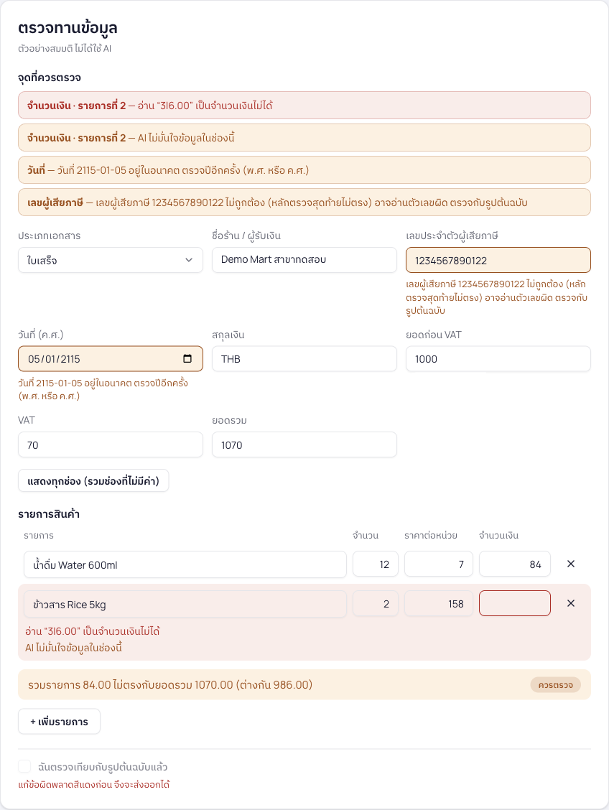

# eve Thai OCR

แปลงรูปใบเสร็จ ใบกำกับภาษี และสลิปโอนเงินภาษาไทย **แบบพิมพ์** ให้เป็นข้อมูลที่ตรวจแล้วและแก้ไขได้ (JSON / CSV) มีทั้งเว็บแอป, ไลบรารี TypeScript และ extension สำหรับ agent ที่สร้างด้วย [eve](https://eve.dev)

[](https://github.com/mintelligence-dev/eve-thai-ocr/actions/workflows/ci.yml)
[](LICENSE)
[](https://eve.dev)
[](https://nextjs.org)
[](https://www.typescriptlang.org)

[English](README.md) · **ภาษาไทย**

**เดโม: <https://eve-thai-ocr.vercel.app>** ลองกดตัวอย่างในหน้าเว็บก่อนได้ ตัวอย่างไม่ได้เรียก AI ส่วนเอกสารที่อัปโหลดจะส่งให้โมเดล AI อ่าน และไม่ถูกเก็บไว้ อย่าอัปโหลดใบเสร็จหรือสลิปของคนอื่น



<sub>ตัวอย่างในหน้าเว็บ ข้อมูลสมมติ ไม่ได้เรียก AI</sub>

เครื่องมือ AI โอเพนซอร์สที่แปลงใบเสร็จและสลิปโอนเงินภาษาไทย **แบบพิมพ์** ให้เป็นข้อมูลที่มีโครงสร้างและแก้ไขได้ (JSON / CSV) สำหรับร้านค้าขนาดเล็ก ฟรีแลนซ์ และนักพัฒนาที่สร้างเครื่องมือบันทึกค่าใช้จ่าย ทุกครั้งจะมีคนตรวจผลก่อนส่งออก

### ทำอะไรได้

- อัปโหลดรูป หรือถ่ายรูปจากมือถือ ระบบย่อรูปบนเครื่องคุณก่อน (ดู [ความเป็นส่วนตัว](#ความเป็นส่วนตัวและข้อมูล))
- **รองรับไฟล์ PDF** (เช่น ใบเสร็จที่บันทึกหรือส่งมาทางอีเมลเป็น PDF) แต่ละหน้าถูกแปลงเป็นรูปบนเครื่องของคุณ แล้วทำงานเหมือนรูปถ่าย จึงอ่านได้สูงสุด 4 หน้าเป็นใบเดียว PDF ที่มีหน้ามากกว่านั้นจะถูกปฏิเสธแทนที่จะตัดหน้าให้เอง เพราะอาจมีหลายใบเสร็จ และ PDF ที่ตั้งรหัสผ่านก็ถูกปฏิเสธ ทดสอบเฉพาะ PDF ที่เป็นภาพสแกนหรือรูป ข้อความที่อยู่ในไฟล์ PDF ไม่ได้ถูกนำมาใช้
- **ใบเสร็จที่ยาวมากถ่ายแยกได้สูงสุด 4 รูป** เรียงจากบนลงล่างและให้รูปซ้อนกันสองสามบรรทัด ระบบอ่านรวมเป็นใบเดียว และ **เช็กให้ว่าเป็นใบเดียวกันจริงไหม** ถ้ารูปดูเหมือนคนละใบ จะปฏิเสธพร้อมข้อความ ไม่รวมให้
- **ใบเสร็จและใบกำกับภาษี:** ชื่อร้าน เลขประจำตัวผู้เสียภาษีของร้าน เลขที่ใบเสร็จ วันที่ เวลา ยอดก่อน VAT VAT ยอดรวม และรายการสินค้า
- **สลิปโอนเงิน:** ผู้รับเงิน ผู้โอน จำนวนเงิน ค่าธรรมเนียม เลขอ้างอิง วันที่ เวลา
- อ่านเลขไทย (๑๒๓) วันที่ พ.ศ. (`12/05/2568` → `2025-05-12`) ชื่อเดือนไทย/อังกฤษ ปีสองหลัก `฿` / `บาท` / `BHT` / `THB` และข้อความผสมไทย–อังกฤษ
- เข้าใจรูปแบบใบเสร็จที่พบบ่อย: ราคามีรหัสภาษีต่อท้าย (`48.75 N`) ราคาต่อหน่วยมีหน่วยต่อท้าย (`41.00 / ชิ้น`) ของเพิ่มที่ราคารวมอยู่ในบรรทัดบนแล้ว และส่วนลดที่เป็นบรรทัดติดลบ
- **ติดธงจุดที่ควรตรวจ** (เหลือง = ช่วยยืนยัน, แดง = ต้องแก้ก่อนส่งออก) ดู [สิ่งที่ระบบตรวจ](#สิ่งที่ระบบตรวจ)
- ตรวจแก้ได้ทุกช่อง และมีตัวอย่างไฟล์ JSON และ CSV ที่จะได้ใต้ฟอร์มแบบสด ส่งออกไม่ได้จนกว่าจะติ๊ก "ฉันตรวจเทียบกับรูปต้นฉบับแล้ว" และไม่เหลือข้อผิดพลาดสีแดง
- หน้าเว็บสองภาษา (ไทย/อังกฤษ) ธีมสว่างและมืด

### ไม่ทำอะไร

- **ดึงข้อมูลเท่านั้น** รูปถ่ายพิสูจน์ไม่ได้ว่าใบเสร็จหรือสลิปเป็นของจริง แอปจึงไม่ตัดสินจากรูป สำหรับสลิปโอนเงินมีตัวเลือกตรวจกับธนาคาร (ดู [ตรวจสลิปกับธนาคาร](#ตรวจสลิปกับธนาคาร)) ซึ่งปิดอยู่จนกว่าคุณจะตั้งค่า
- **รองรับเฉพาะเอกสารที่พิมพ์ ลายมือจะถูกปฏิเสธ** ไม่ใช่อ่านแบบไม่แม่น เพราะตัวเลขลายมืออ่านได้ไม่ตรงกันทุกรอบ (ยอดเดียวกันได้ทั้ง 200,000 / 2,000,000 / 2,009,000 ในการทดสอบ) โดยไม่มีอะไรบนจอเตือนคุณ
- สูงสุด 4 รูปต่อ **หนึ่ง** เอกสาร ใบเสร็จคนละใบไม่ถูกรวมกัน (ดูหัวข้อ "เชื่อถือได้แค่ไหน" ว่าเช็กได้ดีแค่ไหน) ยังไม่มีโหมดอัปโหลดหลายใบพร้อมกัน
- ไม่เชื่อมระบบบัญชี ไม่ส่งข้อมูลไปที่ไหนอัตโนมัติ
- ไม่เก็บรูปของคุณ (ดู [ความเป็นส่วนตัว](#ความเป็นส่วนตัวและข้อมูล)) ไม่มีบัญชีผู้ใช้และไม่มีประวัติย้อนหลัง

### เชื่อถือได้แค่ไหน

พูดตรงๆ: ดี แต่ไม่สมบูรณ์ และผลของรูปเดียวกันอาจต่างกันในแต่ละรอบ ในชุดทดสอบเล็กๆ ของเรา (ใบเสร็จร้านค้า 3 ใบ สลิป 4 ธนาคาร) โมเดลเริ่มต้นอ่านร้าน วันที่ ยอดรวม และ VAT ถูกในส่วนใหญ่ของรอบที่ลอง จุดที่พลาดบ่อยที่สุด:

- **เลขไทยตัวเล็ก** (เช่น `๑๘๕.๐๐` อ่านเป็น `145`)
- บรรทัดที่มีหลายราคา ใบยาวมาก กระดาษความร้อนซีด รูปเอียงหรือเบลอ
- ค่าที่ถูกปิดหรือถูกตัดขอบ

**หลายรูปของใบเดียว** โมเดลอ่านรวมกัน และรายงานด้วยว่าแต่ละรูปแสดงอะไรโดยลำพัง (ร้าน เลขผู้เสียภาษี วันที่ ยอดรวม) แล้วโค้ดเทียบกัน รูปคนละใบจึงถูกปฏิเสธแม้โมเดลเห็นว่าตรงกัน ในชุดทดสอบเล็กๆ ของเรา คู่รูปคนละใบถูกปฏิเสธ 12 จาก 12 ครั้ง (ทั้งใบจริงและสังเคราะห์ รวมร้านเดียวกันคนละวัน) และใบยาวสังเคราะห์ที่มีบรรทัดเหมือนกัน 3 บรรทัดในรอยซ้อนถูกรวมถูกต้อง 3 จาก 3 ครั้ง ส่วนใบจริงที่ตัดเป็นสองท่อน รวมแล้วมีข้อสังเกตเดียวกับรูปเดียว (เช่น บรรทัดหัวข้อถูกนับเป็นรายการ) สิ่งที่ทำไม่ได้: สองรูปที่ไม่เห็นร้าน เลขผู้เสียภาษี วันที่ หรือยอดรวมเลย (เช่นท่อนกลางสองท่อน) จับได้แค่จากการตัดสินของโมเดลและการเช็กยอดรวม จึงควรอ่านผลที่รวมแล้วทุกครั้ง

เพราะแบบนี้แอปจึงเทียบตัวเลขข้ามกันและให้คุณยืนยันจุดที่น่าสงสัย **เทียบกับต้นฉบับทุกครั้ง** ก่อนเปลี่ยนโมเดล ให้รัน [`pnpm bench`](bench/README.md) กับเอกสารของคุณเอง เพราะโมเดลต่างกันมาก (มีตัวที่แต่งใบเสร็จขึ้นมาทั้งใบจากรูปขาวเปล่า)

### สิ่งที่ระบบตรวจ

| ธง | ความหมาย |
|---|---|
| รายการรวมไม่ตรงยอด | ผลรวมรายการต้องเท่ายอดรวม ยอดก่อน VAT หรือยอดรวมหัก VAT (แถบเช็กสดใต้รายการ) |
| VAT | เทียบกับ 7% ใบเสร็จที่มีทั้งสินค้ามี VAT และไม่มี VAT ยอมรับได้ ถ้ามีสินค้า 1–3 ชิ้นรวมกันได้ส่วนที่ไม่มี VAT พอดี |
| เลขผู้เสียภาษี | 13 หลักและหลักตรวจของไทย เลขที่อ่านผิดเกือบทุกครั้งจะไม่ผ่าน |
| วันที่ | ไม่อยู่ในอนาคต ไม่เก่ากว่า 10 ปี ปีสองหลักจะบอกว่าอ่านเป็นปีอะไร |
| จำนวนเงิน | จำนวนเงินที่มีทศนิยมเกิน 2 ตำแหน่ง (`5.555`) ไม่เดาให้ ยอดติดลบต้องมีชื่อที่บอกว่าเป็นส่วนลดหรือโปรโมชัน (`discount`, `promotion`, `ส่วนลด`, `ลดราคา`, `โปรโมชั่น`, `โปรโมชัน`) ชื่ออื่นอย่าง `BOGO` ติดธง |
| โมเดลไม่มั่นใจ | ช่องที่โมเดลบอกว่าอ่านไม่ชัด หรือค่าที่ถูกปิด/ตัดขอบ |
| ไม่ใช่ใบเสร็จ | รูปว่าง อ่านไม่ออก หรือไม่เกี่ยวข้อง ต้องยืนยันก่อนส่งออก |
| หลายรูป | รูปที่ดูเหมือนคนละใบถูกปฏิเสธ ผลที่รวมแล้วมีธงเหลือง "ตรวจบรรทัดตรงรอยต่อของรูป" เสมอ และแถบเช็กยอดรวมยังทำงานอยู่ |
| ค่าที่สมมติ | บรรทัดที่มีแต่ราคา แสดงเป็นจำนวน 1 × ราคา (ตัวเอียงจาง และมี `assumed` ใน JSON) ไม่ทำกับส่วนลดหรือเลย์เอาต์ที่ไม่ชัด |

### หลักการทำงาน

โมเดลมีหน้าที่ **คัดลอกข้อความตามที่พิมพ์** เท่านั้น (ผลลัพธ์ตรวจด้วย Zod ผ่าน Vercel AI SDK) จากนั้นโค้ด TypeScript แบบ deterministic จะแปลงเลข วันที่ และจำนวนเงิน (เก็บเป็นสตางค์จำนวนเต็ม ไม่มีค่าเพี้ยนจากทศนิยม) และรันการตรวจทั้งหมดข้างบน ราคาไม่เคยมาจากการคำนวณของโมเดล ดู [`packages/extractor`](packages/extractor)

```
apps/web                 เว็บเดโม Next.js: อัปโหลด → ตรวจทาน → ดูตัวอย่าง → ส่งออก
packages/extractor       แพ็กเกจ TypeScript ใช้ซ้ำได้: ดึงข้อมูล แปลง ตรวจสอบ ส่งออก ให้คะแนน
packages/eve             eve extension: อ่าน แก้ และส่งออกเอกสารที่แนบมาในแชต
examples/thai-ocr-agent  ตัวอย่าง eve agent ที่ mount extension นี้
bench/                   เทียบโมเดลวิชันด้วยเอกสารของคุณเอง
```

### รูปแบบไฟล์ที่ส่งออก

JSON คือโครงสร้างเต็ม ส่วน CSV มีค่าทุกอย่างที่ JSON มี ยกเว้น `flags` และ `assumed` ของรายการสินค้า ซึ่งบอกว่าตัวเลขถูกอ่านมาอย่างไร ไม่ใช่เนื้อหาเอกสาร (มีเทสต์คุมให้สองไฟล์ตรงกัน) CSV มีหนึ่งแถวต่อหนึ่งรายการสินค้า โดยซ้ำช่องระดับเอกสารทุกแถว ใส่ตัวกำกับ UTF-8 เพื่อให้ Excel เปิดภาษาไทยได้ถูกต้อง และกันอักขระที่ Excel จะนำไปรันเป็นสูตร:

`document_type, document_subtype, merchant, merchant_address, branch, date, time, currency, subtotal, total_discount, taxable_amount, exempt_amount, vat, total, total_in_words, payer, reference, book_number, reference_document, fee, tax_id, recipient_name, buyer_name, buyer_address, buyer_tax_id, payment_method, has_signature, bank_check, bank_check_reason, bank_provider, bank_checked_at, bank_amount, bank_fee, bank_date, bank_trans_ref, bank_sender_bank, bank_sender_name, bank_receiver_bank, bank_receiver_name, slip_qr_bank, slip_qr_reference, item_code, item_description, item_quantity, item_unit, item_unit_price, item_discount, item_amount`

**ช่องของใบเสร็จ** นอกจากร้าน วันที่ และยอดเงิน ระบบอ่านสิ่งที่ใบเสร็จและใบกำกับภาษีของไทยต้องแสดงด้วย ได้แก่ ชื่อเอกสาร (`document_subtype`: ใบเสร็จรับเงิน, ใบเสร็จรับเงิน/ใบกำกับภาษี หรือใบกำกับภาษี) เล่มที่และเลขที่ ที่อยู่และสาขาของผู้รับเงิน ชื่อ ที่อยู่ และเลขผู้เสียภาษีของผู้ซื้อ ส่วนลด มูลค่าที่เสียภาษีและที่ยกเว้น ยอดรวม**เป็นตัวอักษร** วิธีชำระเงิน และมีลายมือชื่อผู้รับเงินหรือไม่ (เก็บแค่ว่ามีหรือไม่ ไม่เก็บลายเซ็น) แต่ละรายการสินค้ามีรหัส หน่วยนับ และส่วนลดได้ด้วย ช่องที่ใบเสร็จไม่ได้พิมพ์จะว่างไว้ บนหน้าตรวจทาน**ช่องที่ไม่มีค่าจะถูกซ่อน** และมีปุ่มเดียวแสดงทั้งหมด ช่องที่การตรวจมีเรื่องจะบอก หรือที่เพิ่งลบค่าเพื่อพิมพ์ใหม่ จะไม่หายไป

การตรวจใหม่ที่ควรรู้มีสองอย่าง คือ ยอดรวมที่เขียนเป็นตัวอักษรจะถูกแปลงเป็นตัวเลขแล้วเทียบกับยอดรวมที่เป็นตัวเลข (ตัวเลขหรือคำที่อ่านผิดจะขึ้นเตือน) และ VAT จะถูกเทียบกับ 7% ของมูลค่าที่เสียภาษี ส่วนเลขผู้เสียภาษีของผู้ซื้อตรวจด้วยหลักตรวจสุดท้ายแบบเดียวกับของผู้ขาย เลขผู้เสียภาษีของผู้ซื้ออาจเป็นเลขบัตรประชาชนของบุคคล คำสั่งระบบอนุญาตให้โมเดลส่งออกเลขนี้ในช่องนั้นเท่านั้น และมันอยู่ในไฟล์ที่ส่งออกเหมือนช่องผู้ซื้ออื่น จึงควรถือว่าไฟล์นั้นมีข้อมูลส่วนบุคคล

ในสลิปโอนเงิน `merchant` คือผู้รับเงิน (ชื่อร้านเมื่อสลิปแสดงชื่อร้าน) และ `reference` คือเลขอ้างอิงรายการ ส่วน `recipient_name` คือชื่อเจ้าของบัญชีผู้รับ เมื่อสลิปแสดงทั้งชื่อร้านและชื่อบุคคล ในใบเสร็จ `reference` คือเลขที่ใบเสร็จ

คอลัมน์ `bank_*` จะว่างถ้าไม่ได้ตรวจสลิปกับธนาคาร (ดู [ตรวจสลิปกับธนาคาร](#ตรวจสลิปกับธนาคาร)) `bank_check` คือ `verified` (ธนาคารมีรายการโอนนี้), `not_found`, `pending` (รายการใหม่เกินไป ยังบอกไม่ได้) หรือ `unavailable` (ธนาคารหรือบริการตอบไม่ได้ ซึ่งไม่ได้บอกอะไรเกี่ยวกับสลิป) `bank_check_reason` บอกเหตุผลเมื่อเป็น `unavailable` คอลัมน์อื่นบอกว่าถามบริการไหน เมื่อไร (เวลาแบบ ISO) และยอด ค่าธรรมเนียม วันเวลา (พร้อมเขตเวลา) เลขอ้างอิง รหัสธนาคารสองฝั่ง และ**ชื่อผู้โอนกับชื่อผู้รับ**ที่**ธนาคาร**รายงาน ส่วน `slip_qr_bank` และ `slip_qr_reference` คือสิ่งที่ QR บนสลิปเก็บไว้ ใน JSON มีข้อมูลเดียวกันที่ `verification` และ `slipQr`

### วิธีติดตั้ง

ต้องมี Node 20+ และ pnpm

```bash
pnpm install
cp apps/web/.env.example apps/web/.env.local   # ใส่ AI_GATEWAY_API_KEY
pnpm dev                                       # http://localhost:3000
pnpm test                                      # รันเทสต์ทั้งหมด
```

ยังไม่มี key? กดตัวอย่างสังเคราะห์ในหน้าเว็บ (หรือเปิด `/?sample=transfer-slip`, `/?sample=thai-receipt`, `/?sample=needs-review`, `/?sample=addon-discount`) เพื่อลองหน้าตรวจทานโดยไม่ต้องเรียกโมเดล

| ตัวแปร | ค่าเริ่มต้น | ใช้ทำอะไร |
|---|---|---|
| `AI_GATEWAY_API_KEY` | – | key ของ [Vercel AI Gateway](https://vercel.com/docs/ai-gateway) ไม่ต้องใช้บน Vercel ถ้าใช้ OIDC |
| `RECEIPT_MODEL` | `google/gemini-2.5-flash` | โมเดลวิชันใดๆ บน AI Gateway (`provider/model`) หน้าตรวจทานแสดงว่าเอกสารนั้นอ่านด้วยโมเดลไหน |
| `RATE_LIMIT_PER_HOUR` | `10` | จำนวนคำขอต่อ IP ผู้เยี่ยมชมต่อชั่วโมง (best effort ดูด้านล่าง) |
| `RATE_LIMIT_PER_DAY` | `200` | จำนวนคำขอทั้งเว็บต่อวัน |
| `SLIP_VERIFY_PROVIDER` | *(ปิด)* | ตั้งเป็น `easyslip`, `slipok` หรือ `slip2go` เพื่อเปิดตัวเลือกตรวจสลิปโอนเงินกับธนาคาร |
| `SLIP_VERIFY_API_KEY` | | คีย์ของบริการนั้น (Slip2Go คือ Secret Key ของร้าน) ต้องตั้งคู่กับ provider |
| `SLIP_VERIFY_BRANCH_ID` | | เฉพาะ SlipOK: สาขาที่คีย์นั้นสังกัด |
| `SLIP_RATE_LIMIT_PER_HOUR` | `20` | จำนวนการตรวจกับธนาคารต่อ IP ต่อชั่วโมง |
| `SLIP_VERIFY_CACHE_DIR` | *(ปิด)* | **ใช้เฉพาะตอนพัฒนา** โฟลเดอร์ที่จดคำตอบที่ธนาคารยืนยันแล้วไว้ แล้วเล่นซ้ำ เพื่อให้การทดสอบไม่เสียโควตาของบริการ ไฟล์มีชื่อและตัวเลข จึงต้องเก็บนอกระบบควบคุมเวอร์ชัน (`bench/private/` อยู่นอกอยู่แล้ว) |

โมเดลเริ่มต้นถูกจำกัดการ "คิด" ไว้ที่ 1,024 token เพราะการอ่านใบเสร็จส่วนใหญ่คือการคัดลอก การคิดไม่จำกัดแค่เพิ่มเวลาและค่าใช้จ่าย: ใบ 17 รายการใช้ ~40 วินาที ~2 เซนต์ เมื่อไม่จำกัด และ ~9–13 วินาที ~0.5 เซนต์ เมื่อจำกัด โดยความแม่นยำไม่ลดลง การปิดการคิดทั้งหมดถูกลงอีกครึ่งหนึ่ง แต่ความแม่นยำในชุดทดสอบของเราตกประมาณ 11 จุด (98% → 87%) จึงไม่แนะนำ (ลองได้ด้วย `pnpm bench -- --thinking 0`)

หน้าเว็บแสดงสิ่งที่โมเดลอ่านได้ทีละส่วน (โหมด `?stream=1` ของ API ส่ง JSON หนึ่งอ็อบเจกต์ต่อหนึ่งบรรทัด) แต่โมเดลใช้เวลาคิดหลายวินาทีก่อนจะเริ่มเขียน ข้อมูลชุดแรกจึงโผล่ช้า (ราววินาทีที่ 10 จาก 13 ในใบยาว) และเวลารวมไม่เปลี่ยน เอกสารลายมือจะถูกปฏิเสธทันทีที่โมเดลบอก โดยไม่รอส่วนที่เหลือ

### ใช้แพ็กเกจ

```ts
import { extractReceipt, DifferentDocumentsError, HandwritingNotSupportedError, toCSV } from "@eve-thai-ocr/extractor";

try {
  const { receipt, usage } = await extractReceipt({
    image: bytes,                     // Uint8Array ของไฟล์ JPEG, PNG หรือ WebP
    mediaType: "image/jpeg",
    model: "google/gemini-2.5-flash", // โมเดลวิชันใดๆ บน AI Gateway
    // ใบยาวหลายรูป เรียงจากบนลงล่าง (สูงสุด 4) ใช้แทน `image`:
    // images: [{ image: top, mediaType: "image/jpeg" }, { image: bottom, mediaType: "image/jpeg" }],
  });
  receipt.flags;                      // จุดที่ควรให้คนตรวจ
  toCSV(receipt);
} catch (e) {
  if (e instanceof HandwritingNotSupportedError) { /* ขอเอกสารที่พิมพ์ออกมา */ }
  if (e instanceof DifferentDocumentsError) { /* รูปไม่ใช่ใบเดียวกัน: e.conflicts บอกว่าต่างกันตรงไหน */ }
}
```

ฟังก์ชันที่ใช้ในเบราว์เซอร์ได้ (ไม่มีโค้ดเรียกโมเดล) เช่น `normalizeExtraction`, `revalidate`, `itemsReconcile`, `toJSON`, `toCSV` อยู่ที่ `@eve-thai-ocr/extractor/core`

### ใช้กับ eve

[`@eve-thai-ocr/eve`](packages/eve) เป็น extension ของ [eve](https://www.npmjs.com/package/eve) คนส่งรูปใบเสร็จหรือสลิปให้ agent ในแชต ตรวจค่าที่อ่านได้ บอกค่าที่ถูกด้วยคำพูดของตัวเอง แล้วขอไฟล์ได้ **ตอนนี้ยังไม่ได้ขึ้น npm** ให้ใช้จาก workspace นี้ (`"@eve-thai-ocr/eve": "workspace:*"`) แบบเดียวกับ agent ตัวอย่าง mount ใน agent แบบนี้

```ts
// agent/extensions/ocr.ts
import ocr from "@eve-thai-ocr/eve";

export default ocr({ model: process.env.RECEIPT_MODEL || undefined }); // ค่าเริ่มต้น google/gemini-2.5-flash
```

agent จะได้ tool 3 ตัว (ขึ้นต้นด้วยชื่อที่ mount ในตัวอย่างคือ `ocr__…`)

| Tool | ทำอะไร |
|---|---|
| `read_document` | อ่านเอกสาร 1 ใบจากรูปที่แนบไม่เกิน 4 รูป (JPEG, PNG หรือ WebP) ด้วยตัวอ่านและการตรวจชุดเดียวกับเว็บ คืน id ค่าที่อ่านได้ และสิ่งที่ต้องแก้ (`mustFix`) หรือควรตรวจ (`pleaseCheck`) |
| `correct_document` | แก้ตามที่คนบอกว่าในกระดาษเขียนไว้ ส่งค่าตามที่พิมพ์ (`"๑,๒๕๐"`, `"12 พ.ค. 68"`) แล้วให้ตัวอ่านแปลงเอง agent จึงไม่ต้องแปลงปีหรือคิดเลขเอง ตรวจใหม่ทุกข้อทุกครั้ง |
| `export_document` | CSV หรือ JSON ตาม [รูปแบบไฟล์ที่ส่งออก](#รูปแบบไฟล์ที่ส่งออก) **ส่งออกไม่ได้ถ้ายังมีจุดที่ต้องแก้** เหมือนที่เว็บล็อกปุ่มส่งออก |

เอกสารเก็บไว้ใน session ของ eve ไม่มีฐานข้อมูล instructions ของ extension สั่งให้ agent ห้ามเอาตัวเลขจากรูปเอง (eve ส่งรูปให้โมเดลของ agent เห็นด้วย) และให้บอกข้อความของ tool ต่อเมื่อ tool ปฏิเสธ [`examples/thai-ocr-agent`](examples/thai-ocr-agent) เป็น agent ที่ใช้งานได้ `pnpm install`, `pnpm build:eve` แล้ว `pnpm dev:agent` จะเปิด terminal UI ของ eve ส่วน `pnpm --filter thai-ocr-agent eval` จะลองอ่านและส่งออกใบเสร็จตัวอย่างตั้งแต่ต้นจนจบ (เรียกโมเดลจริง ต้องมี credential ของ AI Gateway)

สิ่งที่เส้นทาง eve **ยังไม่ทำ** และความเป็นส่วนตัวที่ต่างจากเว็บ

- **ยังไม่รับ PDF และยังไม่ตรวจสลิปกับธนาคาร** เพราะทั้งสองอย่างใช้โค้ดฝั่งเบราว์เซอร์ (pdf.js และ jsQR ที่ใช้หา QR บนสลิป) ไฟล์ PDF หรือ HEIC จะถูกปฏิเสธพร้อมบอกว่าควรส่งอะไรแทน
- **ไม่ได้ย่อหรือล้างรูปก่อน** บนเว็บ เบราว์เซอร์ลบข้อมูล EXIF เช่นพิกัด GPS ก่อนอัปโหลด แต่ในแชต รูปถึง agent ตามที่คนส่งมา และ eve เก็บสำเนาไว้ใน sandbox ของ session (`/workspace/.eve/attachments/`) ตลอดอายุ session
- **รูปถูกส่งให้โมเดลสองครั้ง** ครั้งแรกให้โมเดลของ agent เอง (eve ส่งรูปที่แนบขนาดไม่เกิน 3 MiB ให้เห็น) อีกครั้งให้โมเดลที่อ่านเอกสาร เลือกทั้งสองโมเดลและช่องทางแชตด้วยความระมัดระวังเท่ากับใน [ความเป็นส่วนตัวและข้อมูล](#ความเป็นส่วนตัวและข้อมูล)

### ตรวจสลิปกับธนาคาร

สลิปปลอมหน้าตาเหมือนของจริงทุกอย่าง รูปเพียงอย่างเดียวจึงพิสูจน์อะไรไม่ได้ สิ่งที่ตรวจได้คือ **QR "Slip Verify" เล็กๆ** ที่ธนาคารพิมพ์บนสลิปโอนเงิน ซึ่งมีรหัสธนาคารผู้โอนและเลขอ้างอิงรายการ ให้บริการตรวจสลิปไปถามธนาคารได้ แล้วแอปเทียบ**ยอดและวันที่ที่ธนาคารบันทึก**กับสลิป สลิปที่แก้ยอดแต่ยังใช้ QR ของรายการจริงจะถูกจับได้ เพราะยอดของธนาคารไม่ตรง ช่องยอดจะขึ้นสีแดงและล็อกการส่งออกจนกว่าจะแก้ให้ถูก

- **ปิดอยู่เป็นค่าเริ่มต้น** เลือกบริการด้วย `SLIP_VERIFY_PROVIDER` และใส่คีย์จากบัญชีของคุณเอง: `easyslip` ([EasySlip](https://easyslip.com)) ใช้ `SLIP_VERIFY_API_KEY` ส่วน `slipok` ([SlipOK](https://slipok.com)) ใช้ `SLIP_VERIFY_API_KEY` และ `SLIP_VERIFY_BRANCH_ID` และ `slip2go` ([Slip2Go](https://slip2go.com)) ใช้ `SLIP_VERIFY_API_KEY` ซึ่งคือ Secret Key ของร้าน บริการเหล่านี้คิดค่าบริการ ตรวจราคา โควตาฟรี และเงื่อนไขล่าสุดเอง ถ้าตั้งค่าไม่ครบ หน้าเว็บจะแจ้งเพียงว่ายังไม่ได้ตั้งค่า
- **ไม่ส่งอะไรออกไปจนกว่าผู้ใช้จะกด "ตรวจกับธนาคาร"** การหา QR ทำบนเครื่อง และส่งเฉพาะ**ข้อความ**ใน QR (รหัสธนาคารผู้โอนกับเลขอ้างอิงรายการ) ผ่านเซิร์ฟเวอร์ของคุณไปยังบริการ ไม่ส่งรูปสลิป บริการตอบรายการของธนาคารกลับมา แอปเก็บเลขอ้างอิง วันเวลา ยอด ค่าธรรมเนียม รหัสธนาคารสองฝั่ง และ**ชื่อผู้โอนกับชื่อผู้รับตามที่ธนาคารบันทึก** (ใช้เทียบกับชื่อบนสลิป และอยู่ในไฟล์ JSON ที่ส่งออก จึงควรถือว่าไฟล์นั้นมีข้อมูลส่วนบุคคล) แต่**ไม่เก็บเลขบัญชี**
- **สิ่งที่เทียบกับรายการของธนาคาร** เมื่อธนาคารมีรายการโอนนี้แล้ว แอปเทียบสลิปกับรายการทีละช่อง และแสดงความต่างข้างช่องนั้น: **ยอด**และ**วันที่** (สีแดง ล็อกการส่งออก) กับที่เป็นข้อความเตือนสีเหลืองให้ผู้ใช้ตรวจ คือ **เวลา** (ต่างได้หนึ่งนาที) **ชื่อผู้โอน** **ชื่อผู้รับ** (ชื่อร้านหรือชื่อเจ้าของบัญชี แล้วแต่ธนาคารเก็บอะไรไว้) และ**เลขอ้างอิง** ชื่อเทียบหลังตัดคำนำหน้า (นาย, น.ส., Mr...) และรูปแบบบริษัท (บริษัท, จำกัด, Co., Ltd.) และถือว่าตรงกันเมื่อชื่อหนึ่งอยู่ในอีกชื่อ ชื่อที่ถูกตัดสั้น บรรทัดที่สอง หรือชื่อร้านตามด้วยชื่อบัญชีที่ถูกตัด จึงไม่เตือน ส่วนตัวอักษรที่โมเดลอ่านผิดจะเตือนพร้อมตัวสะกดของธนาคารข้างๆ ซึ่งเป็นจุดประสงค์ (เช่นนามสกุลที่อ่านพยัญชนะผิด) ชื่อที่สลิปเขียนเป็นไทยแต่ธนาคารเก็บเป็นอังกฤษก็เตือน ผู้ใช้เมินได้ ทั้งหมดนี้ไม่ได้พิสูจน์ว่าสลิปจริง เพราะช่องที่เทียบคือช่องที่ธนาคารรายงานเอง
- **การหา QR** ทำบนเครื่อง โดยสแกนภาพเป็นส่วนๆ ทั้งขนาดเดิมและขยาย ลองกับสลิปจริงแล้วเจอ 11 จาก 11 ใบ เป็นภาพจากแอป 7 ใบ และภาพถ่ายหน้าจอด้วยมือถือ 4 ใบ (เอียง มีแสงสะท้อน) ภาพถ่ายเหล่านั้นถูกแอปแชตย่อมาแล้ว รูปจากกล้องขนาดเต็มน่าจะอ่านง่ายกว่า แต่ถ้า QR เล็ก เบลอ หรือถูกครอป จะอ่านไม่เจอ หน้าเว็บจะบอกว่าไม่พบ ซึ่งไม่ได้แปลว่าสลิปปลอม ภาพที่ยากอาจใช้เวลาหนึ่งถึงสองวินาทีบนคอมพิวเตอร์ และนานกว่านั้นบนมือถือ
- **การตรวจที่ไม่ต้องใช้บริการ** ทันทีที่เจอ QR แอปเทียบเลขอ้างอิงที่โมเดลอ่านจากรูปกับเลขที่อยู่ในรหัส ทำบนเครื่อง ไม่ส่งอะไรออกไป และใช้ได้แม้ไม่ได้ตั้งค่าตรวจกับธนาคาร ถ้าไม่ตรง (เช่น `I` อ่านเป็น `l` ตกเลขไปหนึ่งหลัก หรือสลิปที่แก้เลขอ้างอิงแต่ปล่อย QR เดิม) จะขึ้นธงเหลืองพร้อมค่าทั้งสองและปุ่ม "ใช้ค่าจาก QR" ให้ผู้ใช้ตัดสินใจเอง การตรงกันไม่ได้พิสูจน์อะไรเกี่ยวกับสลิป เพราะรหัสไม่มียอดหรือวันที่ สลิปที่แก้ยอดจึงผ่านได้ ในสลิปจริง 11 ใบที่ลอง (SCB, กรุงเทพ, K PLUS) เลขในรหัสตรงกับที่พิมพ์เสมอ ธนาคารอื่นยังไม่ได้ทดสอบ ข้อมูลในรหัสเก็บไว้ใน JSON ที่ `slipQr` เมื่อธนาคารตอบแล้ว จะเทียบกับเลขของธนาคารแทน ไม่เตือนซ้ำสองครั้ง
- **ผลที่ได้ พูดตรงๆ:** ธนาคาร*มี*รายการและตัวเลขตรงกัน (เขียว) ธนาคารมีรายการแต่**ยอดหรือวันที่ไม่ตรง** (แดง ล็อกการส่งออก) ธนาคาร*ไม่พบ*รายการ (เหลือง: สลิปอาจปลอม แต่รายการอาจเพิ่งโอนหรือเป็นธนาคารที่บริการตรวจไม่ได้ก็ได้) ธนาคารยังยืนยันไม่ได้ (เหลือง) บริการตอบไม่ได้ (แสดงเป็นข้อผิดพลาด **ไม่ใช่**คำตัดสินสลิป) ถ้าภายหลังมีการแก้ยอดหรือวันที่ จะถูกเทียบกับตัวเลขของธนาคารใหม่ ไฟล์ JSON/CSV ที่ส่งออกบันทึกผลไว้ (`verification`, `bank_check`)
- **สิ่งที่ไม่ได้ตรวจ:** ผู้รับคือบัญชี*ของคุณ*หรือไม่ (ชื่อและเลขบัญชีถูกปิดบังไม่เหมือนกันในแต่ละสลิป จึงไม่เทียบ) หรือสลิปเดียวกันเคยถูกใช้กับออเดอร์อื่นแล้วหรือไม่ (EasySlip ตรวจให้ได้ แต่แอปนี้ไม่ได้ใช้) สลิปที่ไม่เห็น QR ชัดหรือเป็นธนาคารที่บริการอ่าน QR ไม่ได้ ตรวจไม่ได้ ซึ่งไม่ได้แปลว่าปลอม
- **ทดสอบมาแค่ไหน** Slip2Go ลองกับบริการจริงแล้วด้วยสลิปจริง 5 ใบ (SCB 4 ใบ กรุงเทพ 1 ใบ) ยืนยันได้ 4 ใบ ยอดและวันที่ตรง ส่วนสลิปกรุงเทพได้ "Bank error, please try again" สองครั้ง ซึ่งหน้าเว็บแสดงเป็น "ตอบไม่ได้" ไม่ใช่คำตัดสิน EasySlip (หน้า API v2) และ SlipOK (API guide 1.13) เขียนจากเอกสารสาธารณะและทดสอบกับบริการจำลองในเครื่องที่ตอบตามรูปแบบในเอกสารเท่านั้น **ยังไม่ได้ทดสอบกับบริการจริง** ถ้ารูปแบบคำตอบเปลี่ยน ผลจะแสดงเป็น "ตอบไม่ได้" ไม่ใช่สลิปที่ยืนยันแล้ว
- **ข้อสังเกตเรื่อง SlipOK:** คำขอไม่เคยตั้งตัวเลือก `log` ของเขา SlipOK จึงไม่เก็บข้อมูลสลิปและไม่ตรวจสลิปซ้ำ การตรวจที่สลิปถูกต้องทุกครั้ง รวมถึงการตรวจสลิปเดิมซ้ำ หักโควตาครั้งละหนึ่งหน่วย สลิปของธนาคารกรุงเทพและ SCB อาจต้องรอไม่กี่นาทีถึงตรวจได้ (แสดงเป็น "ยังยืนยันไม่ได้") และเอกสารของเขาให้รหัสข้อผิดพลาดของ "ไม่มีรายการนี้" สองแบบ (1011 และ 1007 ในตัวอย่าง) แอปอ่านทั้งสองเป็น "ไม่พบรายการ"
- **ข้อสังเกตเรื่อง Slip2Go:** คำขอไม่ส่ง `checkCondition` Slip2Go จึงไม่ตรวจสลิปซ้ำ ยอด วันที่ หรือผู้รับ (แอปนี้เทียบยอดและวันที่เอง) เขาไม่มีคำตอบ "รายการใหม่เกินไป" สลิปกรุงเทพหรือ SCB ที่เพิ่งโอนอาจได้ "ไม่พบ" และคำตอบ "Slip is fraud" ของเขาแสดงเป็น "ไม่พบรายการ" เขากำหนด IP ที่เรียกใช้ได้ (ค่าเริ่มต้นเปิดทุก IP) แต่ IP ขาออกของ Vercel เปลี่ยนได้ จึงควรเปิดไว้ เว้นแต่คุณมี IP คงที่
- การตรวจแต่ละครั้งคือการเรียกบริการที่เสียเงิน จึงมีขีดจำกัดต่อผู้เยี่ยมชมแยกต่างหาก (`SLIP_RATE_LIMIT_PER_HOUR` ค่าเริ่มต้น 20) อย่าเปิดเดโมสาธารณะพร้อมคีย์ของคุณโดยไม่มีขีดจำกัด

### เทียบโมเดลด้วยเอกสารของคุณเอง

```bash
pnpm bench -- --dry-run     # ดูแผนและค่าใช้จ่ายคร่าวๆ โดยไม่เรียกโมเดล
pnpm bench                  # ต้องมี AI_GATEWAY_API_KEY ใน apps/web/.env.local
```

ให้คะแนนแต่ละโมเดลกับเฉลยที่คุณเขียนเอง (ร้าน ยอด รายการ เลขผู้เสียภาษี "ห้ามแต่งข้อมูลจากหน้าเปล่า" ฯลฯ) แล้วแสดงความแม่นยำ ความเร็ว และค่าใช้จ่าย เคสสังเคราะห์อยู่ใน `bench/cases/` เอกสารจริงให้เก็บใน `bench/private/` (ไม่ขึ้น git) รายละเอียดที่ [`bench/README.md`](bench/README.md)

### Deploy บน Vercel

[](https://vercel.com/new/clone?repository-url=https%3A%2F%2Fgithub.com%2Fmintelligence-dev%2Feve-thai-ocr&root-directory=apps%2Fweb&env=AI_GATEWAY_API_KEY&envDescription=Vercel%20AI%20Gateway%20key&envLink=https%3A%2F%2Fvercel.com%2Fdocs%2Fai-gateway)

เปิด "Include source files outside of the Root Directory" ไว้ตามค่าเริ่มต้นของ Vercel เพื่อให้แพ็กเกจในเวิร์กสเปซถูกใช้ได้ และ repo ต้องเป็น public ปุ่มจึงจะใช้งานได้

### ค่าใช้จ่าย

ราคาเปลี่ยนได้ โปรดตรวจจากลิงก์ก่อนตัดสินใจ

| รายการ | ที่ควรคาด |
|---|---|
| โมเดล | ประมาณ **0.3–0.6 เซนต์สหรัฐ (ราว 0.1–0.2 บาท) ต่อเอกสาร** กับโมเดลเริ่มต้นในการทดสอบของเรา (ใบซูเปอร์ยาวๆ อยู่ปลายบน) คิดตามจำนวน token ผ่าน [AI Gateway](https://vercel.com/docs/ai-gateway/pricing) ตามราคาของผู้ให้บริการ |
| เครดิตฟรี | ตามเอกสารของ Vercel AI Gateway ให้เครดิตเล็กน้อยรายเดือน (US$5 ทุก 30 วัน นับจากคำขอแรก) และต้องผูกบัตรไว้จึงปลดล็อก ในการทดสอบของเรา โมเดลเริ่มต้นใช้เครดิตนี้ได้ การซื้อเครดิตจะทำให้เสียเครดิตฟรีรายเดือน บัญชีฟรีมีโควตาความถี่ต่ำกว่า คำขอพร้อมกันหลายอันอาจเจอข้อความ "ตอนนี้มีคนใช้เยอะ" |
| โฮสติ้ง | Next.js บน Vercel แผน Hobby ใช้ส่วนตัวที่ไม่ใช่เชิงพาณิชย์ ใช้เชิงพาณิชย์ต้องใช้ Pro ดู [vercel.com/pricing](https://vercel.com/pricing) |

### ปกป้องเดโมของคุณ

เดโมไม่มีระบบล็อกอิน ใครมีลิงก์ก็ใช้งบ API ของคุณได้

- ขีดจำกัดในตัว (`RATE_LIMIT_PER_HOUR`, `RATE_LIMIT_PER_DAY`) เก็บในหน่วยความจำของแต่ละ server instance เป็นแค่เครื่องกันลูปและการใช้พร่ำเพรื่อ **ไม่ใช่เพดานตายตัว**
- เพิ่มกฎ **Vercel Firewall rate limit** ที่ `/api/extract` (Project → Firewall) ซึ่งทำงานข้าม instance
- ตั้ง **AI Gateway budget** ที่ API key (AI Gateway → Budgets) เป็นเพดานค่าใช้จ่ายจริง และปิด auto top-up ไว้

### ความเป็นส่วนตัวและข้อมูล

ใบเสร็จและสลิปมีข้อมูลส่วนบุคคลและข้อมูลการเงิน โปรดอ่านก่อนเปิดให้คนอื่นใช้

- **แอปนี้ไม่เก็บรูปของคุณ** รูปถูกประมวลผลในหน่วยความจำภายในหนึ่งคำขอ สิ่งเดียวที่บันทึกคือรายละเอียดของ error (ชนิด รหัสสถานะ และข้อความสั้นๆ ที่ตัดแล้ว) ไม่มีเนื้อหาของเอกสาร ไม่มีบัญชีผู้ใช้และไม่มีฐานข้อมูล
- **รูปถูกจัดการบนเครื่องก่อน** เบราว์เซอร์แก้การหมุนรูป ย่อรูป และเข้ารหัสใหม่เป็น JPEG ซึ่งล้างข้อมูล EXIF เช่น พิกัด GPS ออกไปด้วย จากนั้นเซิร์ฟเวอร์ตรวจชนิดไฟล์จากไบต์แรกของไฟล์ **ไฟล์ PDF ไม่ถูกส่งไปที่เซิร์ฟเวอร์** เบราว์เซอร์วาดแต่ละหน้าเป็นรูปเอง แล้วอัปโหลดเฉพาะรูป JPEG ที่ได้
- **เฉพาะเมื่อเปิดการตรวจกับธนาคาร:** การกด "ตรวจกับธนาคาร" ส่งข้อความใน QR ของสลิป (รหัสธนาคารผู้โอนกับเลขอ้างอิง ไม่มีรูป) ไปยังบริการตรวจสลิปที่คุณตั้งไว้ ถ้าไม่เปิด จะไม่ส่งอะไรออกไป
- **ผู้ให้บริการโมเดลได้รับรูป** (ผ่าน Vercel AI Gateway) ณ เวลาที่เขียน แคตตาล็อกของ AI Gateway ระบุว่าโมเดลที่ใช้ที่นี่ **ไม่ถูกใช้เทรน** ส่วน **การไม่เก็บข้อมูลเลย (ZDR)** ซึ่งหมายถึงผู้ให้บริการไม่เก็บอะไรไว้หลังตอบ แคตตาล็อกระบุ `gpt-4.1-mini` และ `mistral-small` ว่าทุกผู้ให้บริการ และ Gemini ว่าเพียงบางส่วน การบังคับใช้ ZDR กับทุกคำขอเป็นการตั้งค่าของ AI Gateway ที่ตามหน้าราคาของ Vercel ใช้ได้กับแผน Pro และ Enterprise โปรดตรวจ [เอกสารการจัดการข้อมูลของ AI Gateway](https://vercel.com/docs/ai-gateway) และเงื่อนไขของผู้ให้บริการที่ใช้ เพราะเปลี่ยนได้
- **เลขผู้เสียภาษี:** ระบบอ่านเลขผู้เสียภาษี 13 หลักของ "ร้าน" จากใบเสร็จ ถ้าร้านเป็นบุคคลธรรมดา เลขนี้คือเลขบัตรประชาชนของเขา แอปไม่เก็บไว้ แต่เลขจะอยู่ในไฟล์ที่ส่งออก โมเดลถูกสั่งไม่ให้ดึงเลขบัตรประชาชนของลูกค้า เลขบัตร เบอร์โทร หรือเลขบัญชีธนาคาร
- ข้อความที่พิมพ์บนเอกสารอาจพยายามสั่งโมเดลได้ (prompt injection) ผลลัพธ์ต้องผ่านการตรวจรูปแบบและคนตรวจเสมอ และเซลล์ CSV ที่ขึ้นต้นด้วย `=`, `+`, `-` หรือ `@` ถูกทำให้ปลอดภัยแล้ว แต่ควรถือไฟล์ที่ส่งออกเป็นข้อมูลที่ยังไม่น่าเชื่อถือ
- ถ้าคุณเปิดให้คนอื่นใช้ ควรแจ้งว่ารูปของเขาถูกส่งไปที่ไหน และขอความยินยอมเมื่อกฎหมายกำหนด (เช่น PDPA ของไทย) README นี้ไม่ใช่คำแนะนำทางกฎหมาย
- ใช้ข้อมูลสังเคราะห์เท่านั้นในเทสต์ issue และภาพหน้าจอสาธารณะ ทุกอย่างใน `bench/cases/` ถูกแต่งขึ้น

### ร่วมพัฒนา

เปิด issue หรือ pull request ได้ทั้งภาษาไทยและอังกฤษ ดู [CONTRIBUTING.md](CONTRIBUTING.md) ปัญหาด้านความปลอดภัยให้แจ้งแบบส่วนตัวตาม [SECURITY.md](SECURITY.md) ห้ามเปิดเป็น issue สาธารณะ และห้ามแนบใบเสร็จหรือสลิปจริง

### สัญญาอนุญาต

[MIT](LICENSE)
